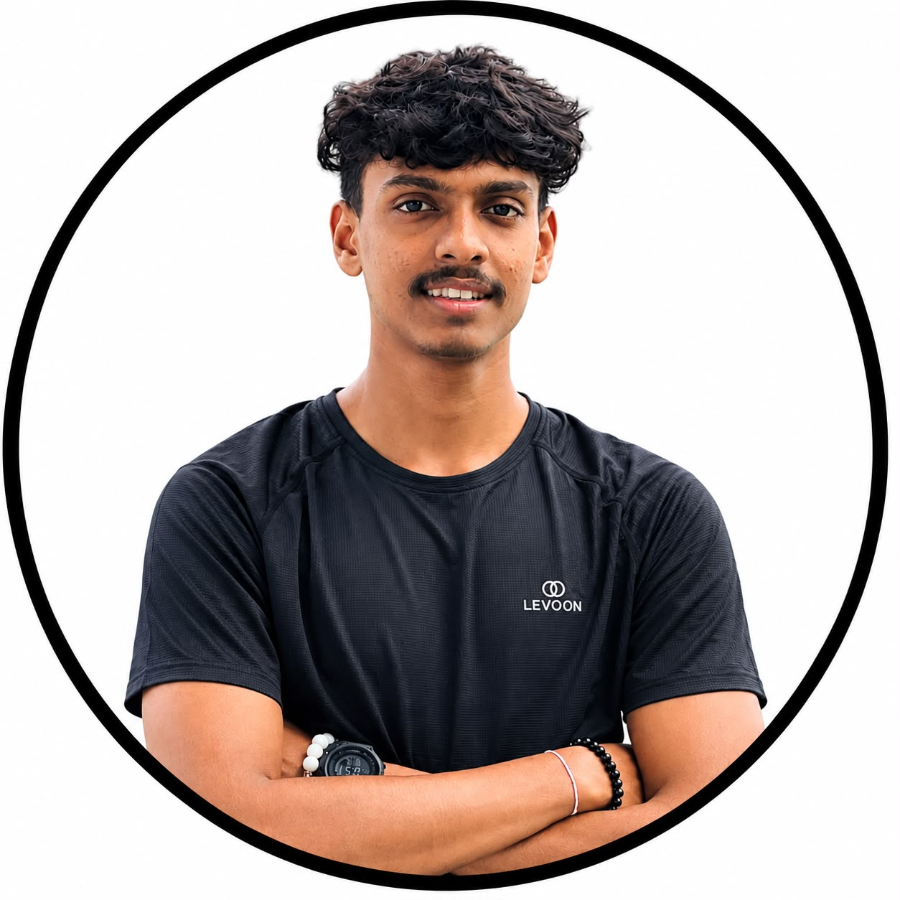

<h1 align="center">
  
</h1>
<h3 align="center">A passionate Full Stack developer from Sri Lanka</h3>

  

-  Fun fact **call me as Hirusha**

<h2 align="center">👨‍💻 About Me</h2>

<table align="center" border="0" cellpadding="8" cellspacing="0">
  <tr>
    <td width="60%" valign="top" align="left">

Hi there! I'm **Hirusha Dilshan Alwis** — a passionate **Full Stack Developer** from Sri Lanka 🇱🇰.

I love turning ideas into clean, functional products — from responsive web apps to cross-platform mobile experiences. I enjoy working across the whole stack: designing the UI, building the API, and wiring up the database.

- 🔭 Currently building **full stack web & mobile apps**
- 🌱 Exploring **Spring Boot, React & Flutter**
- 💬 Ask me about **Java, JavaScript, Node.js, MongoDB**
- 📫 Reach me at **hdrxdev@gmail.com**
- ⚡ Fun fact: **just call me Hirusha**

 

  </td>
    <td width="40%" align="center" valign="middle">

  </td>
  </tr>
</table>

<h2 align="center">🤝 Connect With Me</h2>

  
  &nbsp;
  

<h2 align="center">🛠️ Languages and Tools</h2>

  

  
  

